# BankPro — Customer & Sales CRM

> Smarter Customer Relationships. Better Banking Sales.

A customer-relationship and branch-sales CRM for a **fictional** Bangladeshi bank. Relationship officers
manage customers, work sales leads through a pipeline, convert them into (simulated) sales and keep up with
follow-ups; branch managers approve applications, set targets and watch branch performance.

Built with **Spring Boot 3 · Java 21 · MySQL 8 · React 19 · Tailwind CSS 4**, with role-based access control,
branch-level data isolation and 250+ automated tests.

> **Portfolio project.** All people, products, rates and figures are synthetic. BankPro does not connect to any
> banking system, process real transactions or make lending decisions, and it has not been security- or
> regulator-reviewed.


---

## Why this project

Branch relationship officers juggle customers, product enquiries and call-backs across spreadsheets, notebooks
and phone reminders. Managers find out how the branch is doing at the end of the month. BankPro puts the daily
sales workflow in one place:

- **Officers** see their own customers, leads and today's follow-ups, and how they are tracking against target.
- **Branch managers** see the whole branch, decide on loan and card applications, assign leads and set targets.
- **Head office (admin)** sees every branch side by side and maintains the product catalogue.

Every number on the dashboard is calculated from the database records the viewer is allowed to see.

## Features

| Area | What it does |
|---|---|
| **Customers** | Search, filter, sort and paginate on the server; create and edit with Bangladeshi phone normalisation and duplicate detection; archive/restore; activity timeline; CSV export protected against spreadsheet formula injection |
| **Leads & pipeline** | Kanban board (drag-and-drop *and* a keyboard "Move" menu) and table view; validated stage rules (New → Contacted → Qualified → Proposal → Converted / Lost) with loss reasons; assignment; pipeline value and conversion rate |
| **Lead → sale** | One click converts a lead into a simulated sale. Deposits complete immediately; loans and cards wait for the branch manager's simulated approval. Conversion is idempotent — a lead can never create two sales, even under concurrent clicks |
| **Follow-ups** | Today / upcoming / overdue / completed lists and a month calendar; complete with an outcome, reschedule; overdue reminders as in-app notifications |
| **Sales targets** | Monthly or quarterly targets per officer or for the whole branch (deposit value, new customers, card sales, loan leads, conversions) with live progress and an officer ranking |
| **Dashboard** | 8 KPI cards, each with a written definition; sales, acquisition, pipeline and product-mix charts with a "Show data" table; target progress; officer performance for managers |
| **Reports** | 7 reports (acquisition, pipeline, conversion, product sales, officer performance, target achievement, follow-up completion) with filters, pagination and CSV export |
| **Everywhere** | Global search (`/` or Ctrl+K), notifications, responsive layout (tables become cards on phones), loading/empty/error states, keyboard and screen-reader support |

### Who can do what

| | Relationship officer | Branch manager | Admin |
|---|---|---|---|
| Customers, leads, follow-ups | Own (customers: read whole branch) | Whole branch | All branches, read-only |
| Approve loan/card applications, assign leads, set targets | — | ✔ (own branch) | — |
| Dashboard and reports | Own figures | Branch + per officer | All or one branch |
| Product catalogue | View | View | Create and edit |
| Team list | — | Own branch | All |

Access is enforced on the server — in Spring Security and in every service query — not just by hiding buttons.
A record outside your scope answers **404**, so changing an ID in the URL never reveals another branch's data.

## Screenshots

| | |
|---|---|
| 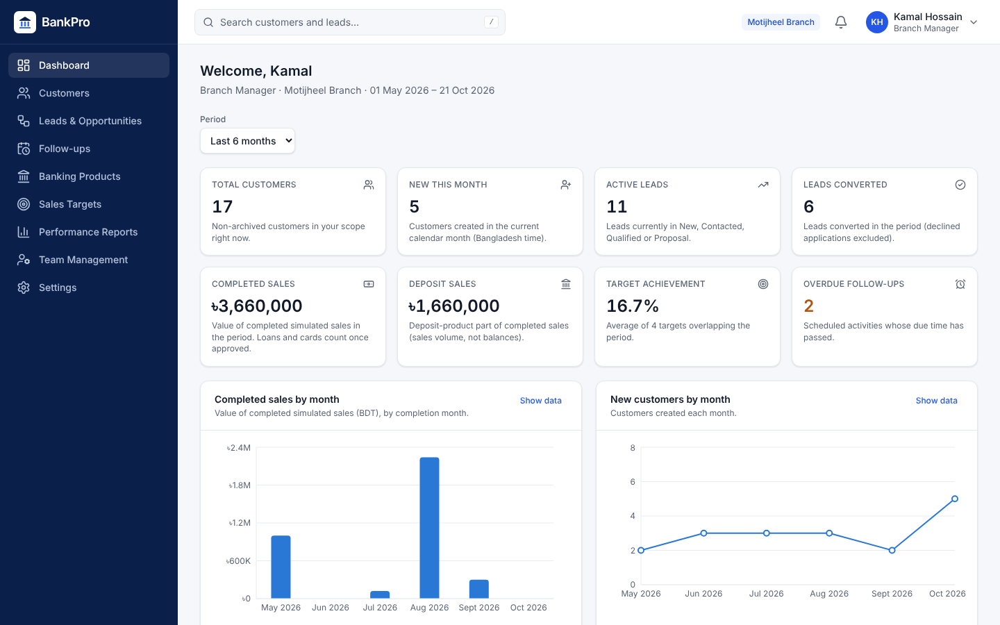 **Manager dashboard** | 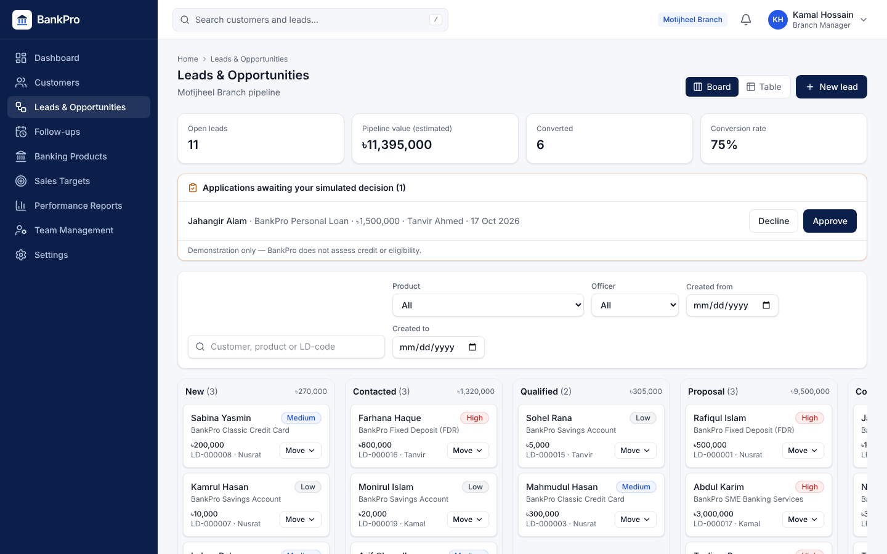 **Lead pipeline with approval queue** |
| 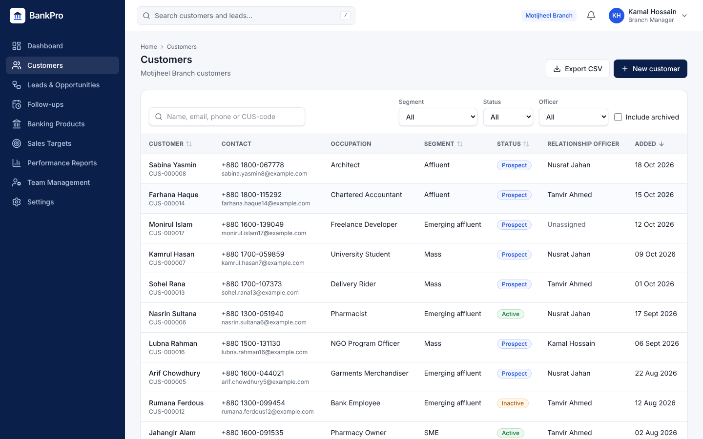 **Customers** | 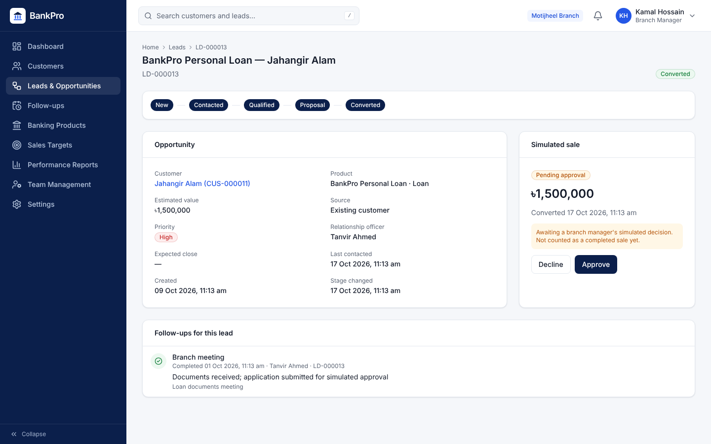 **Lead with pending simulated approval** |
| 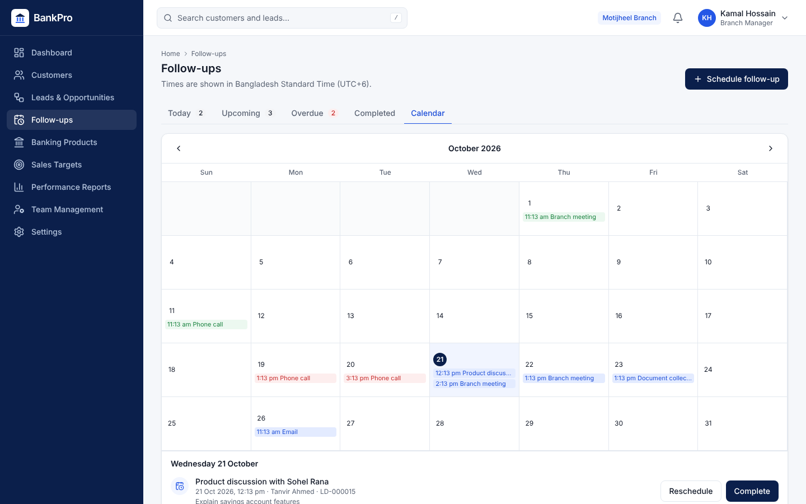 **Follow-up calendar** | 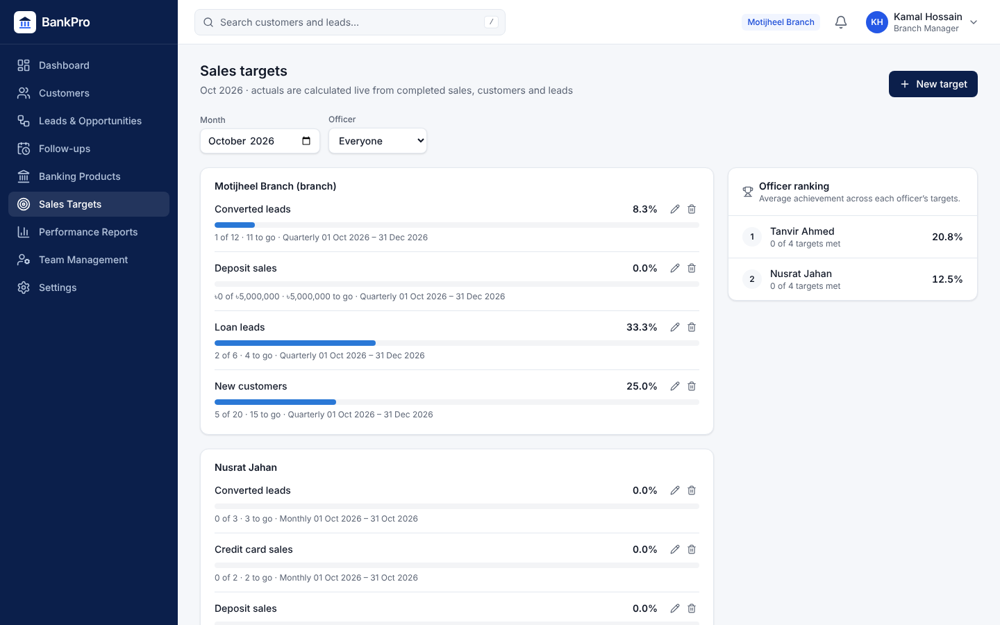 **Sales targets and ranking** |
| 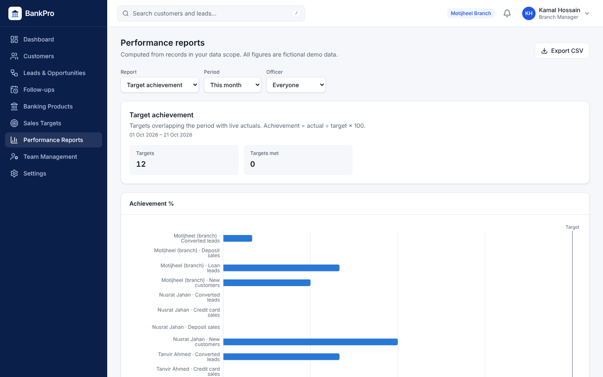 **Target achievement report** | 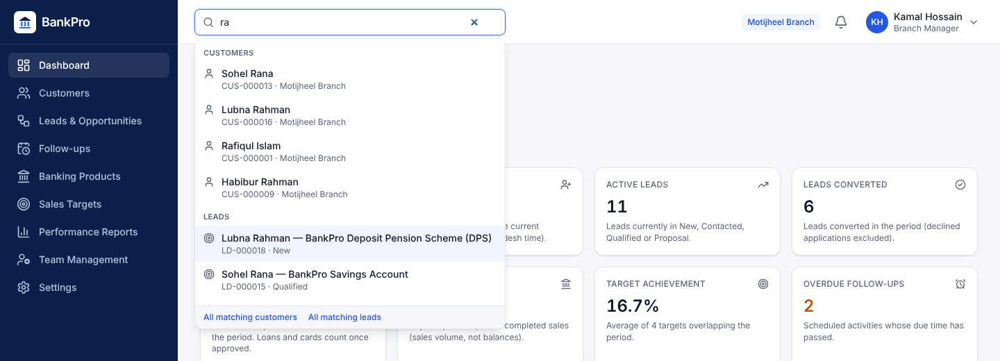 **Global search** |

<p>
  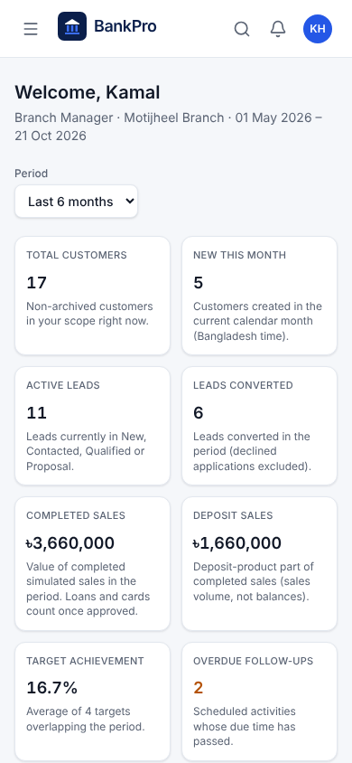
  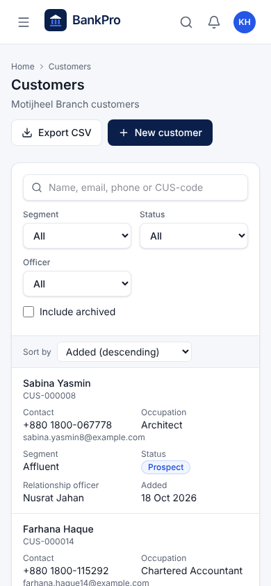
  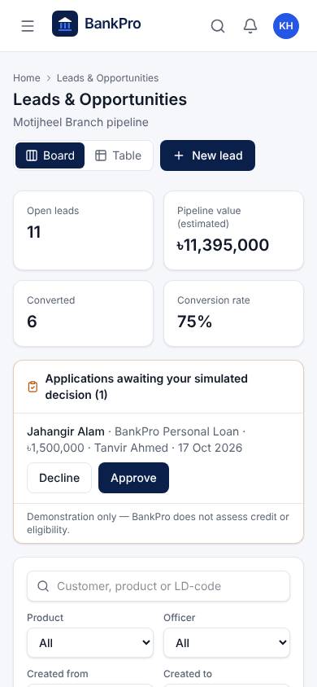
</p>

More: [sign-in](docs/screenshots/01-login.png) · [officer dashboard](docs/screenshots/12-dashboard-officer.png) ·
[full dashboard](docs/screenshots/03-dashboard-manager-full.png) · [customer profile](docs/screenshots/06-customer-profile.png)

## Run it (one command with Docker)

You need [Docker Desktop](https://www.docker.com/products/docker-desktop/) running.

```bash
git clone <this repository> bankpro && cd bankpro
cp .env.example .env          # Windows cmd: copy .env.example .env
```

Edit `.env`: set the two MySQL passwords, and set `JWT_SECRET` to a random value, for example the output of
`openssl rand -base64 48` (on Windows: `"C:\Program Files\Git\usr\bin\openssl.exe" rand -base64 48`). Then:

```bash
docker compose --profile app up -d --build
```

Open **http://localhost:8081** (the first build takes a few minutes). This runs the production configuration —
backend, frontend behind nginx and MySQL — with the fictional demo data loaded.
Stop it with `docker compose --profile app down`.

### Demo accounts

All use the password **`BankPro@2026`** (fictional demo data only).

| Role | Email | Branch |
|---|---|---|
| Administrator | admin@bankpro.demo | All branches |
| Branch Manager | manager.motijheel@bankpro.demo | Motijheel |
| Relationship Officer | nusrat.jahan@bankpro.demo | Motijheel |
| Relationship Officer (Sales Officer) | tanvir.ahmed@bankpro.demo | Motijheel |
| Branch Manager | manager.gulshan@bankpro.demo | Gulshan |
| Relationship Officer | imran.hossain@bankpro.demo | Gulshan |
| *(inactive — sign-in is refused)* | former.officer@bankpro.demo | Motijheel |

A [5-minute demo script](docs/DEMO_SCRIPT.md) walks through the main features.

## Architecture

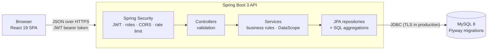

- **Layers:** controllers validate input → services hold every business rule and build each query through a
  `DataScope` (all / branch / own) taken from the signed-in user, never from request parameters → JPA and SQL.
- **Data:** 12 tables created by Flyway migrations, foreign keys and unique constraints (e.g. one sale per lead),
  optimistic locking on edits, UTC storage with Bangladesh-time reporting periods.
- **Metrics:** dashboard and reports are live SQL aggregations with documented definitions — nothing is
  hard-coded or cached ([definitions](docs/ARCHITECTURE.md#5-kpi-definitions-no-double-counting)).
- **Frontend:** feature folders, a small API layer, reusable UI components, URL-synced filters, code-split routes.

Design decisions and their reasons are recorded in [DECISIONS.md](DECISIONS.md) (57 entries);
the full design is in [docs/ARCHITECTURE.md](docs/ARCHITECTURE.md).

## Tech stack

| Layer | Technologies |
|---|---|
| Backend | Java 21, Spring Boot 3.5, Spring Security (OAuth2 resource server, JWT HS256), Spring Data JPA / Hibernate, Bean Validation, Flyway, springdoc-openapi (dev only), Maven |
| Database | MySQL 8 (Docker locally) |
| Frontend | React 19, Vite, React Router 7, Tailwind CSS 4, Axios, Recharts, React Hook Form, Lucide icons |
| Testing | JUnit 5, Mockito, MockMvc, Testcontainers (MySQL), Vitest, React Testing Library, Playwright, axe-core |
| Delivery | Docker (multi-stage images), Docker Compose, nginx; ready for Render + Vercel + Aiven ([guide](docs/DEPLOYMENT.md)) |

## Security

- BCrypt password hashing; JWTs that expire after 60 minutes, kept in memory and session storage (not in cookies or local storage)
- Login rate limiting (5 failures per 15 minutes per email + IP) with generic error messages
- Role checks with `@PreAuthorize` **and** branch/ownership scoping in every service query
- Validation on every request; parameterised queries only; explicit CORS allow-list; security headers and a
  Content-Security-Policy on the frontend
- CSV exports neutralise cells that start like a formula (`=`, `+`, `-`, `@`, tab, carriage return); audit log of logins, customer, lead, sale, target and export actions
- Secrets only in environment variables; `.env` is git-ignored; no customer data in logs

## Testing

| Suite | Command | Result |
|---|---|---|
| Backend — unit + integration against real MySQL (Testcontainers) | `cd backend && mvn test` | **159 passed** |
| Frontend — components, hooks and pages | `cd frontend && npm test` | **72 passed** |
| Browser end-to-end (Playwright) | `cd e2e && npm install && npm run install-browser && npm test` | **20 passed** (+ 6 read-only smoke checks) |
| Accessibility (axe-core, WCAG 2 A/AA) | — | 0 violations on 16 pages × 3 roles × 2 screen sizes |

Highlights: an access-control matrix that tries every write endpoint as another branch, a colleague and the
wrong role; a 6-thread test proving a lead converts only once; KPI figures checked against independent SQL;
and a browser test of the full customer → lead → approval → dashboard → report → CSV journey.
Details and defects found: [docs/QA_REPORT.md](docs/QA_REPORT.md).

## Local development

Prerequisites: JDK 21+, Maven 3.9+, Node.js 22.12+, Docker Desktop.

```bash
docker compose up -d                       # MySQL only, on localhost:3306
cd backend  && mvn spring-boot:run         # API on http://localhost:8080 (Swagger UI: /swagger-ui.html)
cd frontend && npm install && npm run dev  # UI on http://localhost:5173
```

The `dev` profile loads the demo data automatically.

## Project structure

```
backend/   Spring Boot API — controller, service, repository, entity, dto, security, metrics, report …
           src/main/resources/db/migration (schema) · db/dev (fictional demo data)
frontend/  React app — api/, components/ (ui, layout, charts, tables), features/<module>/, routes/, hooks/
e2e/       Playwright browser tests (workflow, access, forms, navigation, exports, smoke)
docs/      ARCHITECTURE · QA_REPORT · DEPLOYMENT · DEMO_SCRIPT · INTERVIEW_GUIDE · screenshots
```

## Deployment

The app is deployment-ready but not hosted. [docs/DEPLOYMENT.md](docs/DEPLOYMENT.md) describes a free setup —
Aiven (MySQL), Render (Docker backend, `render.yaml` Blueprint) and Vercel (frontend, `vercel.json`) — and a
read-only smoke test for the live site. The same production configuration runs locally with Docker Compose (above).

## Limitations

- Fictional demo only: no real customers, no real banking integration, no credit assessment. "Approvals" are simulated decisions.
- Not built: user management screens (the team list is read-only), an audit-log viewer (events are stored in the
  database), password reset, refresh tokens, email/SMS reminders and file uploads.
- Login rate limiting is in memory, so it resets on restart and would need a shared store across several servers.
- Not certified, audited or compliant for real banking use.

---

Built by **[Your Name]** ([LinkedIn](https://www.linkedin.com/in/your-profile) · [GitHub](https://github.com/your-username))
as a portfolio project for banking relationship-officer roles, combining a CSE background with an understanding
of branch sales work.
