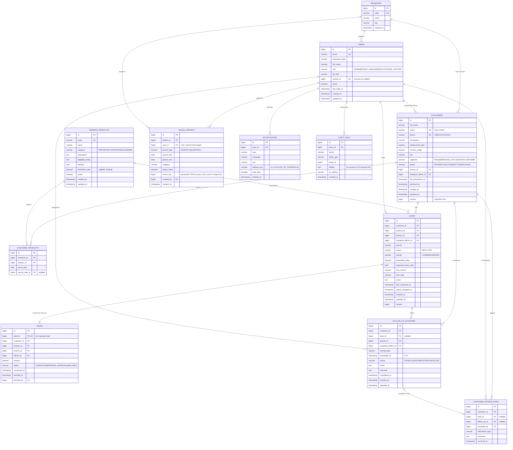
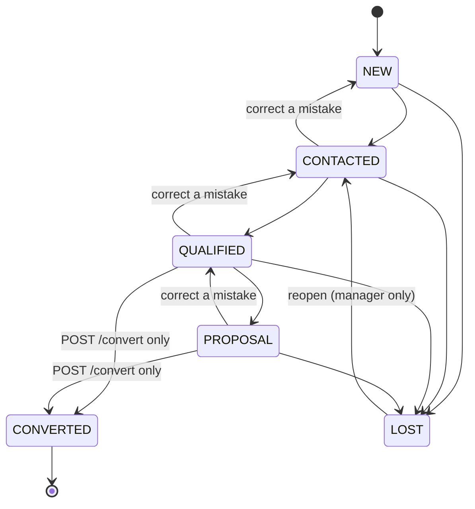

# BankPro — Architecture (Phase 1)

> Smarter Customer Relationships. Better Banking Sales.
> A **portfolio demonstration** CRM for a fictional bank. It never connects to real banking
> systems, never moves money, and never makes lending or eligibility decisions. All data is synthetic.

---

## 1. MVP scope

### In the MVP (must work end-to-end, backed by the database)

| # | Module | What "done" means |
|---|--------|-------------------|
| 1 | Auth & RBAC | JWT login, `/me`, role-filtered navigation, branch-scoped data on every API |
| 2 | Customers | Create, view, edit, archive, server-side search/filter/sort/paginate, CSV export, duplicate prevention |
| 3 | Product catalogue | Browse; ADMIN creates/edits/deactivates; fictional illustrative rates clearly labelled |
| 4 | Leads & pipeline | Table + Kanban, validated stage transitions, loss reasons, assignment, idempotent conversion to a simulated sale |
| 5 | Follow-ups | Today / upcoming / overdue / completed, calendar view, complete, reschedule, interaction notes |
| 6 | Sales targets | Monthly/quarterly targets per officer or branch, actual vs target computed live |
| 7 | Dashboard | 8 KPI cards + 6 charts, date-range and branch filters, all computed from DB |
| 8 | Reports | 7 reports with filters, paginated tables, safe CSV export |
| 9 | Notifications | In-app only: lead assigned, follow-up overdue |
| 10 | Audit log | Append-only record of logins, conversions, assignments, archive, target changes |
| 11 | Team management | ADMIN manages users; MANAGER views own team |

### After the MVP (explicitly deferred)

- Rule-based product recommendation (Section 13 of the brief) — only after modules 1–11 pass QA
- Refresh tokens, password reset by email, SMS/email reminders
- Drag-and-drop file uploads (document collection is recorded as an activity, no files stored)

---

## 2. Roles and permissions

The brief lists **Sales Officer** as a user but defines no separate role. Decision: Sales Officers use the
`RELATIONSHIP_OFFICER` role; their job title is stored on the user (`job_title`). See DECISIONS.md D-07.

**Scope legend:** *Own* = records assigned to me · *Branch* = my branch · *All* = every branch.

| Capability | ADMIN | BRANCH_MANAGER | RELATIONSHIP_OFFICER |
|---|---|---|---|
| View customers | All (read-only) | Branch | Branch (read) |
| Create / edit customers | — | Branch | Own (assigned to me); new customers default to me |
| Archive customers | — | Branch | — |
| Export customers CSV | All | Branch | Own |
| View leads | All (read-only) | Branch | Own |
| Create / edit leads | — | Branch | Own |
| Assign / reassign leads | — | Branch | — |
| Convert lead → sale | — | Branch | Own |
| Approve / decline loan & card applications | — | Branch | — |
| Follow-ups (view / create / complete / reschedule) | All (read-only) | Branch | Own |
| Products: browse | ✔ | ✔ | ✔ |
| Products: create / edit / deactivate | ✔ | — | — |
| Sales targets: create / edit | — | Branch | — |
| Sales targets: view | All | Branch | Own + branch total |
| Dashboard & reports | All, branch filter | Branch, officer filter | Own only |
| Team management | Manage users & roles | View own team | — |
| Audit logs | ✔ | — | — |
| Settings | System settings | Profile | Profile |

**Enforcement layers**

1. `SecurityFilterChain` — every `/api/**` route except `/api/auth/login` requires a valid JWT.
2. `@PreAuthorize` on controller methods — role checks (e.g. only ADMIN may `POST /api/products`).
3. **Service layer** — every query is built through a `DataScope` (ALL / BRANCH(id) / OWN(userId)) derived
   from the authenticated user, never from request parameters. A record outside scope returns **404**, not 403,
   so IDs from other branches cannot be probed (D-08).

---

## 3. Entity–relationship diagram



### Key constraints and indexes

| Table | Constraint / index | Why |
|---|---|---|
| customers | `UNIQUE(email)`, `UNIQUE(phone)` | Duplicate prevention after normalisation |
| customers | `INDEX(branch_id, status)`, `INDEX(assigned_officer_id)`, `INDEX(created_at)` | List filters, acquisition report |
| leads | `INDEX(branch_id, status)`, `INDEX(assigned_officer_id, status)`, `INDEX(created_at)` | Pipeline, Kanban |
| sales | **`UNIQUE(lead_id)`** | Database-level guarantee: one lead → max one sale |
| sales | `INDEX(branch_id, status, converted_at)` | Dashboard and reports |
| follow_up_activities | `INDEX(assigned_officer_id, status, scheduled_at)` | Today / overdue queries |
| sales_targets | `UNIQUE(branch_id, owner_key, period_type, period_start, category)` | No duplicate target rows (`owner_key` maps branch-level NULL user to 0, because MySQL treats NULLs as distinct) |
| all money columns | `DECIMAL(15,2)`, `CHECK (>= 0)` | Exact currency maths (BDT) |

Display codes (`CUS-000123`, `LD-000045`) are formatted from the numeric id in the API, not stored.
`customers`, `leads` and `follow_up_activities` also have a `created_by` FK to `users`.

Derived values are **not stored**: target achievement, conversion rate, pipeline value and KPI totals are
computed with SQL aggregation at request time.

---

## 4. Business rules

### 4.1 Lead stage machine



- `PATCH /status` cannot set `CONVERTED`; only `POST /convert` can, so a sale is always created with it.
- `LOST` requires a `lossReason` (enum: PRICE_OR_RATE, CHOSE_COMPETITOR, NOT_ELIGIBLE, NO_RESPONSE, NO_LONGER_INTERESTED, OTHER + free text).
- Moving out of `NEW` sets `last_contacted_at` if empty.
- Converting requires the product to be active.

### 4.2 Conversion (idempotent, transactional)

Inside one `@Transactional` method:
1. `SELECT … FOR UPDATE` the lead (pessimistic lock — a second concurrent request waits).
2. If the lead is already `CONVERTED` → return the existing sale with **200** (idempotent), never a second sale.
3. If status is not `QUALIFIED`/`PROPOSAL` → **409 Conflict**.
4. Insert the sale; `UNIQUE(lead_id)` is the last line of defence if anything slips past.
5. Sale status depends on product category:
   - `DEPOSIT`, `ACCOUNT`, `SME` → `COMPLETED` (simulated account opened); a `customer_products` row is added.
   - `LOAN`, `CARD` → `PENDING_APPROVAL` (simulated application submitted). A manager later marks it
     `COMPLETED` (simulated approval) or `DECLINED`. **Pending applications never count as completed sales.**
6. Lead → `CONVERTED`; audit log written; customer status `PROSPECT` → `ACTIVE` when the sale is completed.

### 4.3 Customer data rules

- Email trimmed + lower-cased; phone normalised to `+8801XXXXXXXXX` (accepts `01XXXXXXXXX`, `8801…`, `+8801…`).
- Duplicate email or phone → **409** with a field-level message.
- No card numbers, PINs, account numbers, NID numbers or dates of birth are stored.
- "Delete" = archive (`status = ARCHIVED`, `archived_at`). Archived customers are hidden by default but their
  leads, sales and history remain.

### 4.4 Time

- All timestamps stored in UTC (`Instant` ↔ MySQL `TIMESTAMP`/`DATETIME(6)` in UTC).
- Business display and period boundaries use **Asia/Dhaka** ("today", "this month", "overdue", target periods).
- A follow-up is **overdue** when `status = SCHEDULED` and `scheduled_at < now`.

---

## 5. KPI definitions (no double counting)

All KPIs accept `from`, `to` (Asia/Dhaka dates) and respect the caller's data scope.

| KPI | Definition |
|---|---|
| Total Customers | Non-archived customers in scope (point-in-time, ignores date range) |
| New Customers This Month | Customers with `created_at` in the current Dhaka calendar month |
| Active Sales Leads | Leads with status in `NEW, CONTACTED, QUALIFIED, PROPOSAL` |
| Leads Converted | Leads whose sale has `converted_at` in range (counted from `sales`, one row per lead) |
| Total Sales Value | `SUM(sales.amount)` where `status = COMPLETED` and `decided/converted` in range |
| Deposit Sales Value | Same as above, restricted to product category `DEPOSIT` (FDR, DPS) — this is **sales volume**, not balance |
| Target Achievement % | `actual / target × 100` for targets overlapping the range; `—` when no target or target = 0 |
| Overdue Follow-ups | Follow-ups `SCHEDULED` with `scheduled_at < now` |

Terminology kept separate everywhere in the UI:

- **Estimated opportunity value** — `leads.estimated_value` of open leads (pipeline value)
- **Completed simulated sales** — `sales` with status `COMPLETED`
- **Deposit sales volume** — completed sales of DEPOSIT products
- **Deposit balance** — *not tracked*: BankPro has no core-banking ledger (stated in README limitations)

### Target category → actual

| Category | Actual |
|---|---|
| NEW_CUSTOMERS | count customers created in period by/for the officer |
| DEPOSIT_SALES | sum of completed DEPOSIT sales amount |
| CREDIT_CARD_SALES | count of completed CARD sales |
| LOAN_LEADS | count of LOAN leads created in period (this is a lead count, not loan sales) |
| CONVERTED_LEADS | count of sales (any status except DECLINED) converted in period |

---

## 6. API contract (v1)

Base path `/api`. JSON. Errors use one shape:

```json
{ "timestamp": "2026-10-19T03:00:00Z", "status": 409, "error": "Conflict",
  "message": "A customer with this phone number already exists.",
  "path": "/api/customers", "fieldErrors": [{ "field": "phone", "message": "already exists" }] }
```

List endpoints: `?page=0&size=20&sort=createdAt,desc` + filters, returning
`{ content, page, size, totalElements, totalPages }`.

| Method | Path | Roles | Notes |
|---|---|---|---|
| POST | /auth/login | public | Rate-limited; returns `{ accessToken, expiresIn, user }` |
| GET | /auth/me | any | Current user, role, branch |
| GET | /dashboard/summary | any | 8 KPIs; `from,to,branchId?` |
| GET | /dashboard/sales-trend | any | Monthly completed sales value & count |
| GET | /dashboard/lead-funnel | any | Count per stage |
| GET | /dashboard/product-mix | any | Completed sales by product |
| GET | /dashboard/customer-acquisition | any | New customers per month |
| GET | /dashboard/officer-performance | MGR, ADMIN | Per officer sales, conversions, achievement |
| GET | /customers | any | `q, segment, status, occupation, officerId` |
| POST | /customers | MGR, RO | |
| GET | /customers/{id} | any (scoped) | Includes products held |
| PUT | /customers/{id} | MGR, RO(own) | Optimistic locking via `version` |
| DELETE | /customers/{id} | MGR | **Archives**, does not erase |
| GET | /customers/{id}/timeline | any (scoped) | Interactions + follow-ups + lead events |
| GET | /customers/export | any (scoped) | CSV, formula-injection safe |
| GET | /products | any | `active, category` |
| GET | /products/{id} | any | |
| POST | /products | ADMIN | |
| PUT | /products/{id} | ADMIN | Includes activate/deactivate |
| GET | /leads | any (scoped) | `status, productId, officerId, from, to, q` |
| GET | /leads/board | any (scoped) | Kanban grouping |
| POST | /leads | MGR, RO | |
| GET | /leads/{id} | any (scoped) | |
| PUT | /leads/{id} | MGR, RO(own) | Not status |
| PATCH | /leads/{id}/status | MGR, RO(own) | Validated transitions |
| PATCH | /leads/{id}/assign | MGR | |
| POST | /leads/{id}/convert | MGR, RO(own) | Idempotent; `{ amount }` |
| GET | /sales | any (scoped) | `?status=PENDING_APPROVAL` for the manager's approval queue |
| PATCH | /sales/{id}/decision | MGR | Approve/decline loan & card applications |
| GET | /follow-ups | any (scoped) | `view=TODAY|UPCOMING|OVERDUE|COMPLETED|ALL` (+`from,to` for the calendar), `customerId`, `leadId` |
| GET | /follow-ups/counts | any (scoped) | Badge counts for today / upcoming / overdue |
| GET | /leads/summary | any (scoped) | Pipeline figures (SQL aggregation) |
| POST | /notifications/read-all | any | Own notifications only |
| POST | /follow-ups | MGR, RO | |
| PATCH | /follow-ups/{id}/complete | MGR, RO(own) | `{ outcome, notes }` → creates interaction |
| PATCH | /follow-ups/{id}/reschedule | MGR, RO(own) | `{ scheduledAt }` |
| POST | /customers/{id}/restore | MGR | Un-archives a customer |
| POST | /customers/{id}/interactions | MGR, RO(own) | Ad-hoc interaction note |
| GET | /targets | any (scoped) | With computed actual, %, remaining |
| POST | /targets | MGR | |
| PUT | /targets/{id} | MGR | |
| GET | /reports/{type} | any (scoped) | `acquisition, pipeline, conversion, product-sales, officer-performance, target-achievement, follow-up-completion` |
| GET | /reports/{type}/export | any (scoped) | CSV |
| GET | /notifications | any | Own only |
| PATCH | /notifications/{id}/read | any | |
| GET/POST/PUT | /users | ADMIN | MGR may `GET` own branch |
| GET | /users/assignable | any | Active officers/managers in the caller's branch (ADMIN: `?branchId=`) |
| GET | /branches | any | |
| GET | /audit-logs | ADMIN | |

No endpoint hard-deletes sales, leads, interactions or audit logs. Swagger UI is served at
`/swagger-ui.html` in the dev profile.

---

### Phase 5 endpoints (implemented)

| Method | Path | Who |
|---|---|---|
| GET | `/api/dashboard/summary`, `/sales-trend`, `/customer-acquisition`, `/lead-funnel`, `/product-mix`, `/targets` | all roles, scoped |
| GET | `/api/dashboard/officer-performance` | manager, admin |
| GET | `/api/targets?from&to&branchId&userId` | all roles, scoped |
| GET | `/api/targets/ranking` | manager, admin |
| POST / PUT `{id}` / DELETE `{id}` | `/api/targets` | branch manager (own branch) |
| GET | `/api/reports/{type}` and `/api/reports/{type}/export` | all roles, scoped |

Report types: customer-acquisition, lead-pipeline, conversion, product-sales, officer-performance,
target-achievement, follow-up-completion. Common params: `from`, `to`, `branchId` (admin), `officerId`, `page`, `size`.

## 7. Backend structure

```
backend/src/main/java/com/bankpro/
  BankProApplication.java
  config/        CORS, OpenAPI, Clock (Asia/Dhaka), Jackson
  security/      SecurityConfig, JwtService, CurrentUser, DataScope, LoginRateLimiter
  controller/    one controller per resource
  dto/           request/response records with Bean Validation
  entity/        JPA entities + enums
  repository/    Spring Data JPA + Specifications + aggregation queries
  service/       business logic & authorisation checks
  mapper/        entity ↔ DTO mapping (hand-written, no magic)
  exception/     ApiError, GlobalExceptionHandler, NotFound/Conflict exceptions
  validation/    PhoneNumber normaliser, custom validators
  audit/         AuditService
  report/        CsvWriter (formula-injection safe)
backend/src/main/resources/
  application.yml, application-dev.yml, application-prod.yml
  db/migration/V1__schema.sql, V2__seed_reference.sql
  db/dev/       R__dev_seed.sql (synthetic demo data, dev profile only)
```

## 8. Frontend structure

```
frontend/src/
  api/           axios client (JWT header, 401 → logout), one module per resource
  components/
    layout/      AppShell, Sidebar, Topbar, Breadcrumbs, NotificationsPanel, UserMenu
    ui/          Button, Badge/StatusBadge, Card, StatCard, Modal/ConfirmDialog, Toast, FormField,
                 Pagination, SearchBar, FilterPanel, EmptyState, LoadingState, ErrorState, Skeleton
    charts/      SalesChart, FunnelChart, ProductMixChart, TargetChart
    tables/      DataTable
  features/      auth, dashboard, customers, leads, products, followups, targets, reports, users, settings
                 (each: pages/, components/, hooks/)
  hooks/         useAuth, useDebounce, usePagedQuery
  routes/        AppRoutes, ProtectedRoute, RoleGuard, navConfig (role-filtered)
  utils/         formatCurrency (BDT), formatDate (Asia/Dhaka), csv download
```

## 9. Deployment target (Phase 8)

- Frontend → Vercel (`VITE_API_BASE_URL`)
- Backend → Docker image on Render or Railway (free/hobby tiers)
- Database → managed MySQL 8 (Railway MySQL or Aiven for MySQL)
- Secrets via host environment variables only
